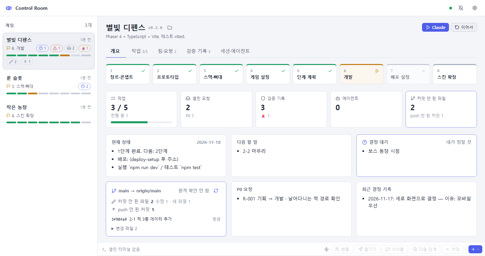

# control_room

[gamestudio](https://github.com/Park-jong/g-studio) 플러그인으로 만드는 게임들을 한 화면에서 보는 로컬 대시보드입니다. 게임마다 진행 단계, 할 일, 결정 대기, 팀 요청, Git 상태를 보여 주고, 브라우저 안의 진짜 터미널로 `claude`를 실행합니다. **이 PC에서만** 열립니다.



<sub>예시 화면입니다. 데모용 가짜 게임 3개로 찍었습니다.</sub>

## 주요 기능

- **게임 목록**: 게임마다 현재 단계, 8단계 진행 막대, 내가 정할 일과 Git 상태를 아이콘으로 보여 줍니다.
- **게임 상세**: 개요 · 작업 · 팀·요청 · 검증 기록 · 세션·에이전트 탭이 있습니다. 기록 파일이 바뀌면 2초 안에 갱신됩니다.
- **웹 터미널**: Claude 새 세션, 마지막 세션 이어서, 세션 재개, 셸을 탭으로 여러 개 띄웁니다. 빠른 명령 버튼으로 `/gamestudio:next` 같은 명령을 바로 보냅니다.
- **게임과 터미널 연동**: 게임을 고르면 그 게임의 터미널로, 터미널을 고르면 그 게임으로 화면이 바뀝니다.
- **알림**: 에이전트 작업이 모두 끝나거나, 결정 대기나 P0 요청이 늘면 데스크톱 알림을 보냅니다. 오른쪽 위 종 버튼으로 켭니다.

## 실행

`start.cmd`를 더블클릭하세요. 처음 실행하면 패키지를 설치한 뒤 서버를 띄우고 브라우저를 엽니다. 직접 실행하려면 아래 명령을 씁니다.

```
npm install
npm start
```

1. 서버 창에 `열기: http://127.0.0.1:4317/?token=...` 주소가 나옵니다. 처음 한 번 이 주소로 열면 브라우저에 접속 권한이 저장됩니다. 그다음부터는 `http://127.0.0.1:4317/`만 열면 됩니다.
2. 처음에는 게임이 없습니다. 오른쪽 위 **설정**(톱니바퀴)에서 게임 폴더를 추가하세요.
   - 게임들이 모여 있는 상위 폴더를 넣으면, 바로 아래 폴더 중 `TODO.md`나 `.dev-team`이 있는 폴더를 게임으로 찾습니다.
   - 게임 폴더를 하나씩 직접 넣을 수도 있습니다.
3. 끝내려면 서버 창에서 Ctrl+C를 누르세요. 열려 있던 웹 터미널도 함께 종료됩니다.

Node.js 20 이상이 필요합니다.

## 화면 읽는 법

### 게임 목록의 아이콘

| 아이콘 | 뜻 |
|---|---|
| ⚑ `6. 개발` | 지금 진행 중인 단계 |
| ⓘ 숫자 | 내가 정해야 할 결정 대기 |
| 로봇 숫자 | 지금 일하는 에이전트 수 |
| 터미널 | 최근 2분 안에 Claude 세션이 움직임 |
| ⚠ 숫자 (빨강) | P0 요청 (현재 단계를 막는 문제) |
| 받은편지함 숫자 | 열린 타 팀 요청 |
| 🚨 숫자 | 반드시 지킬 재발 방지 규칙 |
| ✎ 숫자 | 커밋 안 된 파일 |
| ↑ 숫자 / ↓ 숫자 | push 안 된 커밋 / 원격에서 받을 커밋 |
| 원격 없음 | 이 브랜치를 push 한 적이 없음 |

아이콘에 마우스를 올리면 설명이 나옵니다.

### 상세 탭

| 탭 | 내용 | 읽는 곳 |
|---|---|---|
| 개요 | 8단계 흐름, 작업·요청·검증 기록·에이전트·Git 요약, 현재 상태, 다음 할 일, 결정 대기, Git(브랜치, 변경 파일, push 상태, 마지막 커밋), P0 요청, 최근 결정 | `TODO.md`, `.dev-team/requests.json`, `git` |
| 작업 | 완료된 단계 표, 단계별 목적·완료 조건·범위 밖·위험과 항목 진행, 코드가 정한 해석, 결정 기록 | `TODO.md` |
| 팀·요청 | 타 팀 요청(우선순위·상태), 팀별 할 일과 최근 업무 기록 | `.dev-team/` |
| 검증 기록 | 🚨/⚠️/기록 단계, 횟수, 예방 규칙, 근본 원인, 확인 방법 | `docs/verification-issues.md` |
| 세션·에이전트 | 진행 중인 조직도(팀장·팀원 상태, "팀원 결과 대기"), Claude Code 세션과 서브에이전트, "터미널에서 재개" | `.dev-team/live/`, `~/.claude/projects/` |

URL 끝에 `#work`, `#sessions`처럼 탭 이름을 붙이면 그 탭부터 열립니다.

### Git 상태

- Git 상태는 10초마다 다시 읽습니다. 커밋 안 된 파일과 push 안 된 커밋은 바로 보입니다.
- 원격에서 받을 커밋은 마지막 원격 확인(fetch) 기준입니다. 개요의 Git 칸에서 새로 고침 버튼을 누르면 새로 셉니다. 대시보드가 저절로 fetch 하지는 않습니다.

## 터미널

- 게임 이름 옆의 **Claude**(새 세션)·**이어서**(마지막 세션) 버튼이나 아래 막대의 **+** 메뉴로 엽니다. 셸도 + 메뉴에 있습니다. 세션·에이전트 탭에서는 지난 세션을 골라 재개할 수 있습니다.
- 빠른 명령 버튼:

  | 버튼 | 보내는 명령 |
  |---|---|
  | 현황 | `/dev-team-status` |
  | 맡기기 | `/dev-team ` (뒤에 작업 내용을 입력) |
  | 사이클 | `/gamestudio:dev-cycle ` (뒤에 작업 내용을 입력) |
  | 다음 단계 | `/gamestudio:next` |
  | 커밋 | `/gamestudio:commit-release` |

- 터미널은 서버에서 돕니다. 브라우저를 새로 고치거나 닫아도 계속 실행되고, 다시 열면 최근 출력이 다시 보입니다.
- 글자를 선택한 채 Ctrl+C를 누르면 복사됩니다. 선택한 글자가 없으면 그대로 중단 신호가 갑니다.
- 터미널 높이는 경계선을 끌어서 바꿉니다.

## 순서 바꾸기

| 대상 | 마우스 | 키보드 | 저장 |
|---|---|---|---|
| 게임 목록 | 카드를 끌어 놓기 | 카드에서 Alt+↑/↓ | 설정에 저장 |
| 터미널 탭 | 탭을 끌어 놓기 | 탭에서 Alt+←/→ | 서버가 켜져 있는 동안 |

## 설정 (`.local/config.json`, git 제외)

| 항목 | 기본값 | 설명 |
|---|---|---|
| 게임 상위 폴더 / 게임 폴더 | 없음 | 화면의 설정에서 추가 |
| claude 실행 파일 | PATH에서 찾음 | |
| 플러그인 폴더 | `../gamestudio` | |
| `--plugin-dir`로 실행 | 켜짐 | 플러그인을 `claude plugin install`로 설치했다면 **끄세요**. 켜 두면 두 벌로 동작합니다 |
| 셸 | `powershell.exe` | |
| 게임 순서 (`order`) | 비어 있음 | 목록에서 끌어 놓으면 저장됩니다 |
| 포트 | 4317 | `config.json`의 `port` 또는 환경 변수 `PORT` |

## 조직 현황이 보이는 원리

- 플러그인의 hook이 조직 상태가 바뀔 때마다 `<게임>/.dev-team/live/<세션 id>.json`에 기록합니다. 세션이 끝나면 `ended: true`를 남깁니다. 이 폴더는 자동으로 git에서 제외됩니다.
- 서브에이전트 목록은 Claude Code가 남기는 `~/.claude/projects/<폴더>/<세션>/subagents/*.meta.json`에서 읽습니다. 플러그인 없이 실행한 세션도 보입니다.
- "활동 중"은 세션 기록이 2분 안에 바뀌었거나, 끝나지 않은 서브에이전트가 있다는 뜻입니다. 끝났다는 표시 없이 15분 넘게 조용한 서브에이전트는 "응답 없음"으로 보입니다.

## 보안

웹 터미널은 이 PC에서 명령을 실행합니다. 그래서 다음을 지킵니다.

- `127.0.0.1`에만 열어서 다른 기기에서는 접속할 수 없습니다. 이 설정을 바꾸지 마세요.
- 접속 토큰(`.local/token`)을 HttpOnly 쿠키로 확인하고, Host·Origin 헤더를 검사합니다. 다른 사이트가 이 서버를 부르지 못하게 하기 위해서입니다.
- 토큰이 든 주소는 남에게 보내지 마세요. 토큰을 바꾸려면 서버를 끄고 `.local/token`을 지운 뒤 다시 실행합니다.

## 개발

- `npm test`: 기록 파일 파서, 목록 요약, Git 상태 해석 테스트 (`test/`)
- 구성 (빌드 단계 없음)

  | 경로 | 역할 |
  |---|---|
  | `server/index.js` | HTTP·WebSocket, 인증 |
  | `server/projects.js` | 게임 찾기, 요약·상세 |
  | `server/parse.js` | `TODO.md` 등 마크다운 해석 |
  | `server/sessions.js` | 세션 기록, 조직 현황 |
  | `server/git.js` | Git 상태, 원격 확인 |
  | `server/terminals.js` | node-pty 웹 터미널 |
  | `public/` | 화면 (HTML·CSS·JS) |

- 테스트용으로 띄울 때는 다음 환경 변수로 실제 설정과 분리할 수 있습니다. README의 예시 화면도 이렇게 가짜 게임으로 찍었습니다.
  - `CONTROL_ROOM_DATA_DIR`: 설정·토큰 위치
  - `CLAUDE_CONFIG_DIR`: 세션 기록 위치
  - `PORT`: 포트
- 한글이 터미널에서 넓게 보이면 고정폭 한글 글꼴(D2Coding 등)을 설치하세요. 화면이 그 글꼴을 먼저 씁니다.
